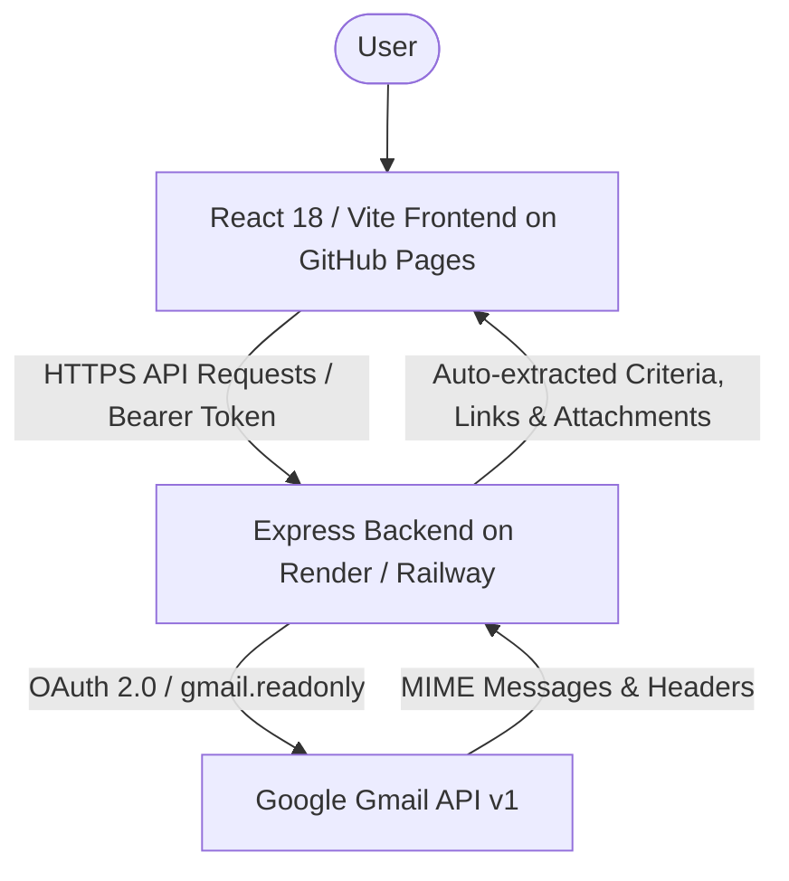

# Subject Mail Viewer 📬

> **Unified Gmail & Google Groups Campus Placement Mail Viewer**  
> A full-stack web application that connects to your Google account, aggregates all Gmail messages and Google Group announcements matching specific subjects (e.g., **Campus Recruitment**, **Online Test**, **Internship**, **CRMIT Solutions**, **Trikaal Tech**), and displays them with auto-extracted eligibility criteria, labeled links, and attachments.

---

## 📋 Table of Contents

1. [Overview](#1-overview)
2. [Features](#2-features)
3. [Tech Stack](#3-tech-stack)
4. [Project Structure](#4-project-structure)
5. [Local Installation & Quick Start](#5-local-installation--quick-start)
6. [Environment Variables](#6-environment-variables)
7. [Google Cloud Console Setup (OAuth 2.0)](#7-google-cloud-console-setup-oauth-20)
8. [GitHub Repository Setup](#8-github-repository-setup)
9. [Frontend Deployment (GitHub Pages)](#9-frontend-deployment-github-pages)
10. [Backend Deployment (Render, Railway, etc.)](#10-backend-deployment)
11. [Production OAuth Configuration](#11-production-oauth-configuration)
12. [Security Instructions](#12-security-instructions)
13. [Session Persistence & Ephemeral Hosting Analysis](#13-session-persistence--ephemeral-hosting-analysis)
14. [Google Groups Gmail Delivery Limitation](#14-google-groups-gmail-delivery-limitation)
15. [Instant Demo Mode](#15-instant-demo-mode)

---

## 1. Overview

College placement cells and university departments send critical recruitment announcements through two channels:
1. **Direct Personal Gmail** (e.g. from placement officers: `sathyabamaplacement@gmail.com`).
2. **Google Group Mailing Lists** (e.g. `sathyabama-pc-2027-engg@googlegroups.com`, `Sathyabama-2027-Engg@googlegroups.com`).

**Subject Mail Viewer** brings both channels together into a single unified dashboard. When you search or select **`Campus Recruitment`**, it retrieves all relevant messages, extracts key details, and presents them in a structured modal:



---

## 2. Features

- **Google OAuth 2.0 Authentication**: Seamless "Continue with Google" using official OAuth flow; minimum read-only scope (`gmail.readonly`).
- **Session Persistence Across Page Refresh**: Auth state is cached in browser `localStorage` and disk-persisted in `server/data/sessions.json`. Refreshing the page (F5) never logs you out.
- **Smart Placement Subject Filters**: Pre-configured chips for `Campus Recruitment`, `Online Test`, `CRMIT Solutions`, `Trikaal Tech`, `Internship`, `Registration`.
- **Pre-set Search Shortcuts**: Quick drawer presets for `sathyabamaplacement@gmail.com` and Sathyabama Google Groups (`sathyabama-pc-2027-engg@googlegroups.com`, `Sathyabama-2027-Engg@googlegroups.com`).
- **Structured Email Detail Modal**:
  1. **Eligibility Criteria**: Company Name, Venue, Eligible branches, Academic Eligibility, Internship Stipend, CTC, Role (`Date` omitted for cleaner schedule alignment).
  2. **NeoPat / NeoPad Alert**: Displays a mandatory action card if both a placement link and a visit link exist.
  3. **Labeled Links**: Extracted URLs with 1-click **Copy Link** and **Open Link** buttons (`groups.google.com` links filtered out).
  4. **Attachments**: Direct download for Job Descriptions (JDs) and notices.
  5. **Collapsible Email Body**: Clean toggle to inspect raw HTML/text email content.
- **Instant Demo Mode**: Test the complete application instantly with mock Sathyabama recruitment emails without configuring Google Cloud.

---

## 3. Tech Stack

- **Frontend**: React 18, Vite 6, Tailwind CSS, Lucide Icons, Axios.
- **Backend**: Node.js, Express, `googleapis` (Gmail API v1 & OAuth2), `express-session`, `helmet`, `cors`, `dotenv`.
- **Deployment Architecture**:
  - **Frontend**: GitHub Pages (static Single Page App deployed via GitHub Actions).
  - **Backend**: Node.js cloud host (Render, Railway, Fly.io, etc.).

---

## 4. Project Structure

```text
subject-mail-viewer/
├── .github/
│   └── workflows/
│       └── deploy.yml            # GitHub Actions CI/CD for GitHub Pages
├── client/                       # React / Vite Frontend
│   ├── src/
│   │   ├── components/
│   │   │   ├── GoogleSignInCard.jsx
│   │   │   ├── MessageItem.jsx
│   │   │   ├── MessageModal.jsx  # Criteria -> NeoPat alert -> Links -> Attachments
│   │   │   ├── Navbar.jsx
│   │   │   ├── RefreshBar.jsx
│   │   │   ├── StatsCards.jsx
│   │   │   └── SubjectSearchBox.jsx
│   │   ├── pages/
│   │   │   ├── DashboardPage.jsx
│   │   │   ├── GroupsPage.jsx
│   │   │   ├── MessagesPage.jsx
│   │   │   └── SettingsPage.jsx
│   │   ├── services/
│   │   │   └── api.js            # Axios client with VITE_API_URL & Bearer interceptor
│   │   ├── App.jsx               # Auth state & localStorage sync
│   │   ├── main.jsx
│   │   └── index.css
│   ├── .env.example
│   ├── package.json
│   ├── tailwind.config.js
│   └── vite.config.js            # base: './' & /api proxy to localhost:5050
│
├── server/                       # Node.js / Express Backend
│   ├── routes/
│   │   ├── authRoutes.js         # OAuth URL, callback, restore-session, demo, logout
│   │   └── mailRoutes.js         # Search, stats, message details, attachments
│   ├── services/
│   │   ├── demoService.js        # Mock Sathyabama placement dataset
│   │   ├── gmailService.js       # Gmail API integration & criteria extractor
│   │   ├── googleAuthService.js  # OAuth2 client & token revocation
│   │   └── sessionStore.js       # File-backed session store
│   ├── .env.example
│   ├── package.json
│   └── server.js                 # Express server on port 5050 with CORS & trust proxy
│
├── .env.example                  # Root environment variable template
├── .gitignore                    # Comprehensive secrets & build filter
├── package.json                  # Root runner script
├── start.bat                     # Windows 11 launcher
└── README.md
```

---

## 5. Local Installation & Quick Start

### 1. Clone or Open the Workspace
```powershell
cd d:\RTX\subject-mail-viewer
```

### 2. Install Dependencies
```powershell
npm run install:all
```
*(Or install individually: `cd server && npm install`, then `cd ../client && npm install`)*.

### 3. Configure Local Environment
Copy `.env.example` to `server/.env`:
```powershell
cp .env.example server/.env
```
Fill in your Google OAuth Client ID and Secret if connecting real accounts, or leave `ENABLE_DEMO_MODE=true` to test with mock data.

### 4. Run Locally
```powershell
npm run dev
```
- **Backend**: Runs on `http://localhost:5050`
- **Frontend**: Runs on `http://localhost:5173`

Open **`http://localhost:5173`** in your browser.

---

## 6. Environment Variables

### Backend (`server/.env` and Cloud Environment Variables)

| Variable | Local Default | Production Example | Description |
| :--- | :--- | :--- | :--- |
| `PORT` | `5050` | `10000` (auto by host) | Port on which Express server listens |
| `CLIENT_URL` | `http://localhost:5173` | `https://username.github.io` | Allowed frontend origin for CORS |
| `SESSION_SECRET` | `dev_secret_key` | `random_64_char_string` | Express session cookie encryption key |
| `GOOGLE_CLIENT_ID` | `...apps.googleusercontent.com` | `...apps.googleusercontent.com` | OAuth Client ID from Google Cloud |
| `GOOGLE_CLIENT_SECRET` | `GOCSPX-...` | `GOCSPX-...` | OAuth Client Secret (**KEEP PRIVATE**) |
| `GOOGLE_REDIRECT_URI` | `http://localhost:5050/api/auth/callback` | `https://backend.onrender.com/api/auth/callback` | OAuth redirect callback URI |
| `ENABLE_DEMO_MODE` | `true` | `true` or `false` | Enables instant demo preview |

### Frontend (`client/.env` and GitHub Actions Secrets)

| Variable | Local Development | Production (GitHub Pages) | Description |
| :--- | :--- | :--- | :--- |
| `VITE_API_URL` | *(empty or `http://localhost:5050`)* | `https://your-backend.onrender.com` | Deployed backend URL |
| `VITE_BASE_PATH` | `./` | `./` (or `/<repo-name>/`) | Asset base path for GitHub Pages |

---

## 7. Google Cloud Console Setup (OAuth 2.0)

1. Open [Google Cloud Console](https://console.cloud.google.com/).
2. Create a project: **Campus Placement Notify** (or **Subject Mail Viewer**).
3. Go to **APIs & Services > Library**, search for **Gmail API**, and click **Enable**.
4. Go to **APIs & Services > OAuth consent screen**:
   - Choose **External** user type.
   - Enter **App Name**: `Campus Placement Notify`.
   - Enter **User support email** and **Developer contact email**.
   - Under **Scopes**, add `https://www.googleapis.com/auth/gmail.readonly`.
5. Under **Test Users**:
   - Click **+ Add Users** and enter your Gmail address (and any student test emails).
   - Click **Save**. *(Test users can sign in immediately without Google verification)*.
6. Go to **APIs & Services > Credentials**:
   - Click **+ Create Credentials > OAuth client ID**.
   - Application Type: **Web application**.
   - Name: `Subject Mail Viewer Web Client`.
   - **Authorized JavaScript origins**:
     - `http://localhost:5173` (for local dev)
     - `https://YOUR_USERNAME.github.io` (for GitHub Pages production)
   - **Authorized redirect URIs**:
     - `http://localhost:5050/api/auth/callback` (for local dev)
     - `https://YOUR-BACKEND-DOMAIN/api/auth/callback` (for production)
7. Click **Create** and copy your **Client ID** and **Client Secret**.

---

## 8. GitHub Repository Setup

Prepare your local repository to push to GitHub:

```bash
# 1. Initialize git (if not already initialized)
git init

# 2. Check that .gitignore is excluding .env and sessions.json
git status

# 3. Add all safe files
git add .

# 4. Commit changes
git commit -m "Prepare Subject Mail Viewer for GitHub and web hosting"

# 5. Set main branch
git branch -M main

# 6. Add your remote GitHub repository
git remote add origin https://github.com/YOUR_USERNAME/YOUR_REPOSITORY.git

# 7. Push to GitHub
git push -u origin main
```

---

## 9. Frontend Deployment (GitHub Pages)

> [!IMPORTANT]
> **GitHub Pages hosts the frontend only. The Express backend must be hosted separately.**

### Automated GitHub Actions Deployment
The project includes a ready-to-run workflow at `.github/workflows/deploy.yml`.

### Step 1: Enable GitHub Pages in your Repository
1. In your GitHub repository, go to **Settings > Pages**.
2. Under **Build and deployment > Source**, select **GitHub Actions**.

### Step 2: Add your Backend URL as a Secret / Variable
1. In your GitHub repository, go to **Settings > Secrets and variables > Actions**.
2. Click **New repository variable**:
   - Name: `VITE_API_URL`
   - Value: `https://your-backend.onrender.com` (your deployed backend URL from Section 10).
3. Click **Add variable**.

### Step 3: Trigger Deployment
Push to `main` (or run manually from the **Actions** tab). GitHub Actions will:
- Check out the repository.
- Install frontend dependencies (`npm ci`).
- Build the Vite project (`npm run build`).
- Deploy `client/dist` to GitHub Pages.

Your frontend will be live at:
`https://YOUR_USERNAME.github.io/YOUR_REPOSITORY/`

---

## 10. Backend Deployment

Deploy the Node.js Express backend to a free/low-cost cloud platform:

### Deploying to Render.com (Recommended)
1. Sign up at [Render.com](https://render.com/).
2. Click **New + > Web Service**.
3. Connect your GitHub repository.
4. Set the configuration:
   - **Root Directory**: `server`
   - **Environment**: `Node`
   - **Build Command**: `npm install`
   - **Start Command**: `node server.js`
   - **Plan**: `Free`
5. Under **Environment Variables**, add:
   - `NODE_ENV` = `production`
   - `PORT` = `10000` (or leave default assigned by Render)
   - `CLIENT_URL` = `https://YOUR_USERNAME.github.io/YOUR_REPOSITORY`
   - `SESSION_SECRET` = *(Generate a random 32+ character string)*
   - `GOOGLE_CLIENT_ID` = `your_google_client_id.apps.googleusercontent.com`
   - `GOOGLE_CLIENT_SECRET` = `your_google_client_secret`
   - `GOOGLE_REDIRECT_URI` = `https://YOUR-APP-NAME.onrender.com/api/auth/callback`
   - `ENABLE_DEMO_MODE` = `true`
6. Click **Deploy Web Service**.
7. Once deployed, test the health check endpoint in your browser:
   `https://YOUR-APP-NAME.onrender.com/api/health`
   Should return: `{"status":"ok", ...}`.

---

## 11. Production OAuth Configuration

Once your frontend (GitHub Pages) and backend (Render) URLs are ready, update Google Cloud Console:

1. Open **Google Cloud Console > APIs & Services > Credentials**.
2. Click your OAuth 2.0 Web Client to edit it.
3. Under **Authorized JavaScript origins**, add:
   ```text
   http://localhost:5173
   https://YOUR_USERNAME.github.io
   ```
4. Under **Authorized redirect URIs**, add:
   ```text
   http://localhost:5050/api/auth/callback
   https://YOUR-APP-NAME.onrender.com/api/auth/callback
   ```
5. Click **Save**.

### OAuth Publishing Note:
- In **Testing Mode**, any email address added under **OAuth Consent Screen > Test Users** can log in immediately.
- To enable access for all Google accounts without adding them individually to Test Users, fill in the **Branding** tab (App name, Support email, Home page URL, Privacy policy URL) and click **Publish App**. Users will see an unverified app banner where they can click **Advanced > Go to Campus Placement Notify (unsafe)** to sign in.

---

## 12. Security Instructions

1. **Never commit `.env` or `server/.env`**: Keep credentials strictly inside environment variable managers.
2. **Never expose `GOOGLE_CLIENT_SECRET` in the frontend**: The client secret is only used on the backend for code exchange.
3. **Keep tokens out of version control**: Access tokens and refresh tokens are stored in the server's session store and never committed.
4. **Least Privilege Scopes**: The application only requests `gmail.readonly` and cannot alter or send messages.
5. **Account Disconnect**: Clicking **Disconnect Google Account** revokes OAuth tokens on Google's authorization servers.

---

## 13. Session Persistence & Ephemeral Hosting Analysis

### Local Environment:
Active sessions are saved to `server/data/sessions.json` on disk and cached in the browser's `localStorage`. Restarting the dev server or refreshing the page retains login state seamlessly.

### Ephemeral Cloud Hosting (e.g. Render Free Tier / Railway):
Free cloud hosts frequently spin down inactive instances or redeploy to fresh ephemeral containers where files written at runtime are not permanent across restarts.
- **How our app handles this**:
  - The frontend caches user information in `localStorage` and automatically calls `/api/auth/restore-session`.
  - For **Demo Mode**, sessions are restored without requiring any login.
  - For **Live Google OAuth**, if an ephemeral container restarts and its in-memory/file cache is wiped, the user simply clicks **Continue with Google** to re-authorize.
  - For enterprise production requiring months of persistent session storage across multiple container replicas, attach a managed database such as MongoDB Atlas, Redis, or PostgreSQL.

---

## 14. Google Groups Gmail Delivery Limitation

> **Architecture Boundary**: The Gmail API does not have direct access to private web-only Google Groups discussion forums. It only reads messages that are delivered to the authenticated user's Gmail inbox.  
> If an announcement was posted to a Google Group but never delivered to your inbox (e.g. you joined the group after the announcement was sent or email forwarding was disabled), the modal displays:  
> *"This Google Group message is not available in your Gmail mailbox."*

---

## 15. Instant Demo Mode

To test or demo the application without configuring Google Cloud:
1. Open the application.
2. Click **`Try Instant Demo`**.
3. The dashboard populates with authentic placement announcements:
   - **CRMIT Solutions** (Cloud Developer Trainee JD)
   - **Trikaal Tech Enterprises** (Structural Engineering)
   - **Hexaware Technologies** (NeoPat Assessment)
   - **Zoho Corporation** (Technical Interview Shortlist)
   - **Cognizant Technology Solutions** (Slot Booking)
4. Full testing of eligibility criteria extraction, NeoPat alerts, labeled links, and attachment downloads is available.

---

## 📄 License

MIT &bull; Created for high-efficiency campus placement and recruitment email viewing.
